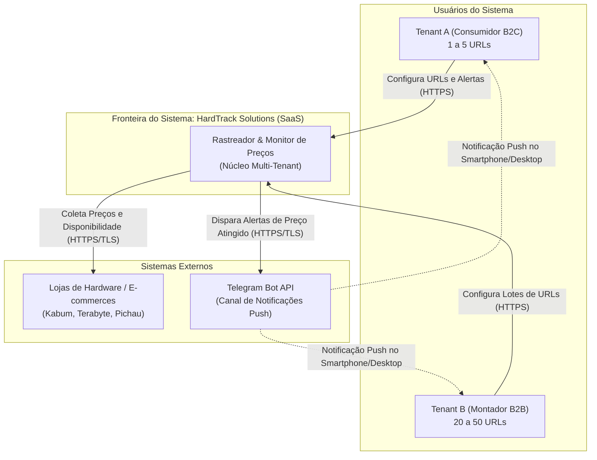
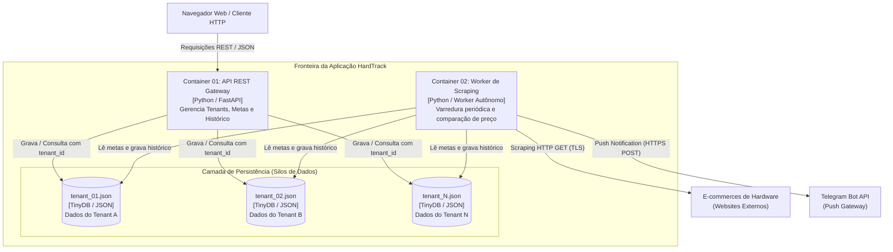

# Diagramas de Arquitetura C4

Esta pasta contém a modelagem da arquitetura de software da plataforma **HardTrack Solutions** segundo o **Modelo C4** (Contexto, Containers, Componentes e Código), criado por Simon Brown.

---

## 1. Nível 1 — Diagrama de Contexto do Sistema

Representa a visão macro do sistema, seus usuários e suas integrações com sistemas externos.

* **Arquivo Interativo:** [diagrama_nivel_1_contexto.html](file:///home/guilhermemachry/Documents/Projeto_SAAS/docs/c4/diagrama_nivel_1_contexto.html)
* **Elementos Centrais:**
  - **Sistema HardTrack Solutions (SaaS Multi-Tenant):** Núcleo central que orquestra a coleta de preços e alerta os usuários.
  - **Usuários / Personas:** Consumidor Final (B2C) e Pequena Montadora/Oficina (B2B).
  - **Sistemas Externos:**
    - *E-commerces de Hardware:* Plataformas externas (Kabum, Pichau, Terabyte, Amazon) de onde os preços são extraídos via scraping HTTPS.
    - *Telegram Bot API:* Serviço de mensageria externo utilizado para despachar notificações push com links de afiliados.

---

## 2. Nível 2 — Diagrama de Containers

Mapeia as unidades de software executáveis que compõem o sistema e como se comunicam.

* **Arquivo Interativo:** [diagrama_nivel_2_containers.html](file:///home/guilhermemachry/Documents/Projeto_SAAS/docs/c4/diagrama_nivel_2_containers.html)
* **Containers Executáveis:**
  1. **Interface / App (SPA / Frontend):** Interface do usuário para cadastro de componentes e visualização de preços.
  2. **API Backend (Python / FastAPI):** Gateway REST responsável pelas regras de negócio, autenticação e gestão de ciclo de vida do tenant.
  3. **Camada de Persistência (Silos JSON / TinyDB):** Segregação física dos dados em arquivos independentes (`storage/tenants/tenant_<id>.json`), garantindo isolamento estrito de tenancy.
  4. **Worker de Monitoramento & Scraping (Python):** Processo em background autônomo com motor BeautifulSoup4 que itera periodicamente sobre os silos, extrai os preços e dispara notificações via Telegram.

---

## 3. Nível 3 — Esboço de Componentes Críticos

Para o detalhamento interno dos componentes de software que formam a API e o Worker, bem como os mecanismos de isolamento de tenant, consulte:
👉 **[esboco_nivel_3_componentes.md](file:///home/guilhermemachry/Documents/Projeto_SAAS/docs/c4/esboco_nivel_3_componentes.md)**
