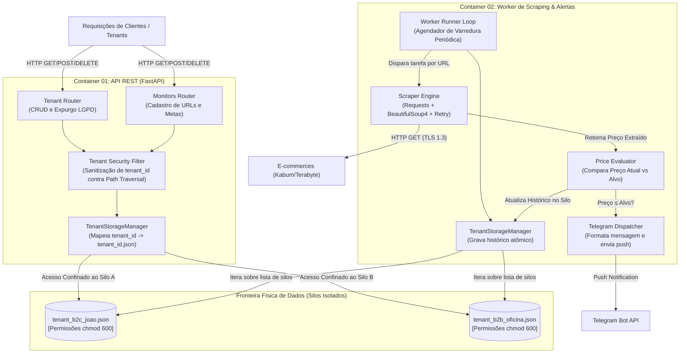

# Esboço do Nível 3 (Componentes) — Componentes Críticos

Este documento detalha o **Nível 3 (Componentes)** do Modelo C4 para os dois containers centrais da aplicação: o **Container de API REST** e o **Container do Worker de Scraping**, destacando expressamente os **limites de isolamento de tenant** (*Tenant Boundaries*).

---

## 1. Diagrama de Componentes e Limites de Tenant

---

## 2. Detalhamento dos Componentes Críticos

### 2.1. Componente: `TenantStorageManager` (Núcleo de Isolamento)
* **Responsabilidade:** Único ponto de contato com o sistema de arquivos para operações de persistência.
* **Garantia de Tenancy:**
  - Recebe obrigatoriamente um identificador `tenant_id`.
  - Executa sanitização estrita via regex (`^[a-zA-Z0-9_-]+$`), rejeitando qualquer caractere de diretório (`/`, `\`, `..`), mitigando ataques de *Path Traversal*.
  - Resolve dinamicamente o arquivo físico: `storage/tenants/tenant_<tenant_id>.json`.
  - Uma chamada para obter dados do `Tenant A` é incapaz fisicamente de tocar no arquivo do `Tenant B`.
* **Suporte a LGPD (Art. 18):**
  - Implementa o método `delete_tenant(tenant_id)` que executa a remoção atômica do arquivo silo no sistema operacional.

### 2.2. Componente: `ScraperEngine` (Módulo de Coleta Resiliente)
* **Responsabilidade:** Efetuar requisições HTTP seguras aos e-commerces e extrair os preços dos seletores HTML/DOM.
* **Resiliência e Políticas de Tolerância a Falhas:**
  - Timeout estrito de 5 segundos por requisição;
  - Política de retentativas com *Exponential Backoff* (tentativas com intervalo de 1s, 2s e 4s);
  - Fallback gracioso caso o site esteja fora do ar ou mude o layout: log estruturado do erro sem causar crash no processo do Worker.

### 2.3. Componente: `PriceEvaluator` (Regras de Domínio)
* **Responsabilidade:** Confrontar o menor preço encontrado com a meta definida pelo tenant.
* **Lógica Ubíqua:**
  - Se `preco_atual <= preco_alvo`, sinaliza a ocorrência de uma oportunidade e invoca o `TelegramDispatcher`.
  - Grava no histórico cronológico do silo o registro com timestamp ISO-8601.

### 2.4. Componente: `TelegramDispatcher` (Canal de Notificação)
* **Responsabilidade:** Montar o payload da notificação e despachar via HTTP POST para a API do Telegram.
* **Recursos:**
  - Inclusão do link do produto com a tag de afiliado da plataforma para monetização;
  - Modo mock integrado para execução local e testes sem dependência de chaves de API externas ativas.
