# Mapa de Contextos (Domain-Driven Design — DDD)

**Disciplina:** Arquitetura de Software SAAS (8512) · EC7 · SETREM  
**Projeto:** HardTrack Solutions — Rastreador e Monitor de Preços de Hardware  
**Etapa:** Etapa 2 — Núcleo Multi-Tenant (Artefato 2.4)  
**Autor:** Guilherme Machry  

---

## 1. Visão Geral do Domínio

Segundo Eric Evans (*Domain-Driven Design*, 2003) e Vaughn Vernon (*Implementing DDD*, 2013), a correta modelagem arquitetural divide o problema pelas fronteiras naturais do negócio (*onde o negócio muda de assunto*).

Para a plataforma **HardTrack Solutions**, foram identificados três **Bounded Contexts (Contextos Delimitados)**:

```mermaid
flowchart LR
    subgraph ContextoTenant ["Contexto de Gestão de Tenants & Identidade<br>(Supporting Domain)"]
        TenantEntity["Entidade: Tenant<br>(B2C / B2B)"]
        ContactVO["Objeto de Valor: Telegram Contact"]
    end

    subgraph ContextoMonitoramento ["Contexto de Monitoramento & Scraping<br>(Core Domain)"]
        MonitorEntity["Entidade: Componente Monitorado"]
        PriceVO["Objeto de Valor: Cotação de Preço"]
        TargetVO["Objeto de Valor: Preço-Alvo"]
    end

    subgraph ContextoNotificacao ["Contexto de Notificações & Alertas<br>(Supporting Domain)"]
        AlertEntity["Entidade: Alerta de Oportunidade"]
        AffiliateVO["Objeto de Valor: Link de Afiliado"]
    end

    ContextoTenant -->|"Upstream (U) / Fornece Tenant e Chat ID"| ContextoMonitoramento
    ContextoMonitoramento -->|"Upstream (U) / Publica Oportunidade Detectada"| ContextoNotificacao
```

---

## 2. Bounded Contexts Detalhados

### 2.1. Contexto de Gestão de Tenants & Identidade (*Supporting Domain*)
* **Propósito:** Gerenciar o ciclo de vida do cliente do SaaS, suas preferências e credenciais de comunicação.
* **Fronteira Ubíqua:** Foca em *quem é o cliente*, seu plano de uso e seus direitos de privacidade (LGPD).
* **Conceitos do Modelo:**
  - `Tenant` (Entidade / Raiz de Agregado): Identificador único, tipo de perfil (`B2C_ENTUSIASTA` ou `B2B_OFICINA`), status ativo/inativo.
  - `ContatoNotificacao` (Value Object): Telegram Chat ID validado.
  - `ExpurgoLGPD` (Evento de Domínio): Solicitação formal de exclusão definitiva do tenant e de todos os seus silos.

### 2.2. Contexto de Monitoramento & Extração de Preços (*Core Domain*)
* **Propósito:** Núcleo de valor da empresa. Rastrear páginas de hardware, interpretar o DOM e detectar quedas de preço.
* **Fronteira Ubíqua:** Foca no *produto físico*, na URL e na dinâmica de variação monetária de mercado.
* **Conceitos do Modelo:**
  - `ComponenteMonitorado` (Entidade): Nome do hardware, URL alvo de e-commerce, seletor de extração, status.
  - `PrecoAlvo` (Value Object): Valor numérico monetário (R$) que o cliente deseja pagar.
  - `CotacaoHistorica` (Value Object): Registro imutável de data/hora, preço encontrado e loja de origem.
  - `CicloVarredura` (Serviço de Domínio): Execução ordenada de consultas sobre o lote de componentes de um tenant.

### 2.3. Contexto de Notificações & Alertas (*Supporting Domain*)
* **Propósito:** Transformar eventos de oportunidade de compra em mensagens ricas entregues instantaneamente ao cliente.
* **Fronteira Ubíqua:** Foca no *formato da mensagem*, no *canal de entrega* e na *monetização por afiliados*.
* **Conceitos do Modelo:**
  - `AlertaOportunidade` (Entidade): Vínculo entre a cotação favorável e o tenant destinatário.
  - `LinkAfiliado` (Value Object): URL com injeção de parâmetros de parceiro comercial da HardTrack.
  - `DespachanteTelegram` (Adaptador de Infraestrutura / ACL): Comunicação com a API externa da plataforma Telegram.

---

## 3. Context Map (Mapa de Relações entre Contextos)

O relacionamento entre os contextos estabelece o fluxo de dependências e a integridade do modelo:

| Contexto Origem (Upstream) | Contexto Destino (Downstream) | Tipo de Relação | Justificativa Arquitetural |
| :--- | :--- | :---: | :--- |
| **Gestão de Tenants** (U) | **Monitoramento** (D) | **Customer / Supplier (C/S)** | O contexto de monitoramento consome a identidade do tenant e os limites do seu plano para orquestrar as URLs cadastradas. |
| **Monitoramento** (U) | **Notificações** (D) | **Published Language (PL)** | O monitoramento emite um evento padronizado (`OportunidadePrecoAtingido`) contendo os dados do componente, preço atual e chat ID. O contexto de notificações consome esse evento sem acoplamento reverso. |
| **E-commerces Externos** (U) | **Monitoramento** (D) | **Anti-Corruption Layer (ACL)** | A camada de scraping atua como uma barreira de anticorrupção, traduzindo o HTML/DOM instável das lojas para um objeto de valor limpo e tipado (`CotacaoPreco`). |

---

## 4. Linguagem Ubíqua (Glossário do Negócio)

Para assegurar que código, documentação e discussões de negócio utilizem rigorosamente os mesmos termos:

* **Tenant:** A unidade de conta e isolamento do cliente no sistema (seja um consumidor final B2C ou uma oficina montadora B2B).
* **Componente Monitorado:** Uma peça de hardware específica associada a uma URL de e-commerce que deve ser checada pelo sistema.
* **Preço-Alvo:** O valor teto estipulado pelo tenant; qualquer preço encontrado menor ou igual a esse valor ativa um alerta.
* **Ciclo de Varredura:** Uma iteração autônoma do Worker que percorre as URLs ativas, realiza o scraping e persiste as leituras.
* **Alerta de Oportunidade:** Notificação push gerada quando o preço capturado atende à regra de preço-alvo do tenant.
* **Silo de Dados:** O arquivo JSON independente (`tenant_<id>.json`) que guarda todo o estado exclusivo de um tenant.
* **Expurgo LGPD:** A deleção física, definitiva e atômica do silo de dados do tenant para cumprimento da legislação.

---

## 5. Coerência com os Diagramas C4

O mapa de contextos reflete com exatidão a divisão apresentada no C4:
- O **Contexto de Gestão de Tenants** e a camada de entrada do **Contexto de Monitoramento** estão corporificados no **Container API (FastAPI)**;
- O motor de varredura do **Contexto de Monitoramento** e o **Contexto de Notificações** estão corporificados no **Container Worker (Python)**;
- Os limites de tenant do DDD são materializados fisicamente na camada de **Silos de Dados (TinyDB)**.
